# Thronglet animations — situation map (issue #37)

R&D source of truth for [issue #37](https://github.com/enegalan/thronglets-infinite/issues/37). Playthrough evidence comes from [Black Mirror: Thronglets, full game and ending](https://www.youtube.com/watch?v=UtreOZO9A3s) (frames in [`video-frames/`](video-frames/); denser marks under `t004-*` / `t068-*` for eat/wash). Situation wiring must cite a frame (or stay unwired). Asset names from `references/Assets/Sprite/` and the runtime atlas in [`scripts/data/throng_clips.gd`](../scripts/data/throng_clips.gd). Selection today lives in [`Main._frame`](../scripts/presentation/Main.gd).

**Per-animation sheets:** one PNG per clip (frames left → right). Runtime source: [`../resources/sprites/throng_anims/`](../resources/sprites/throng_anims/). Doc mirror: [`thronglet-anims/`](thronglet-anims/). Export with `python3 tools/export_throng_anims.py`.

`ThrongClips` resolves clips by name (`frame_at` / `strip_frame` / `sprite_frames`). MultiMesh still batches through `world_iso.png` cells packed **from those strips** in `make_art` (iso y-sort with props). AnimatedSprite / Sprite2D paths use the strip PNGs directly.

## Priority tiers

Interrupt hierarchy (higher wins):

| Tier | Name                | Role                                                                                         |
| ---: | ------------------- | -------------------------------------------------------------------------------------------- |
| 4    | Cutscene override   | Console dialogue stare, unlock celebrate swarm, possessed/glitch talks, scripted SEQ moments |
| 3    | Critical / one-shot | Mitosis, death, panic/freak near kill or fire, deflesh, egg hatch                            |
| 2    | Direct interaction  | Eat, bath, wash, play (ball / roundabout / jump), work pickaxe, carry haul                   |
| 1    | Base / needs        | Idle flavor, walk, walk_homed, mood (sad / bored / grumpy), sleep, peer sing / talk-to-other |

Within the same tier, prefer the more specific trigger (e.g. penned fear over calm idle).

## Per-animation strips

Each clip is **one PNG**: several sprites in a row (left → right).

| Role           | Path                                                                                                                                                                                              |
| -------------- | ------------------------------------------------------------------------------------------------------------------------------------------------------------------------------------------------- |
| Runtime strips | [`res://resources/sprites/throng_anims/`](../resources/sprites/throng_anims/) + [`manifest.json`](../resources/sprites/throng_anims/manifest.json)                                                |
| Doc mirror     | [`thronglet-anims/`](thronglet-anims/)                                                                                                                                                            |
| Export         | `python3 tools/export_throng_anims.py`                                                                                                                                                            |
| API            | `ThrongClips.frame_at(clip, tick)` → MultiMesh cell; `ThrongClips.strip_frame(clip, tick)` → `AtlasTexture` from the strip; `ThrongClips.sprite_frames()` → `SpriteFrames` for `AnimatedSprite2D` |

`make_art` packs strip bodies into `world_iso.png` so the swarm MultiMesh keeps correct iso sorting with props.

## Runtime clip inventory (`ThrongClips.CLIPS`)

### Talk / social / cutscene

| Clip                                        | Frames | Situation              | Strip                                                                                                                                    |
| ------------------------------------------- | -----: | ---------------------- | ---------------------------------------------------------------------------------------------------------------------------------------- |
| `ThrongA_AngryAtPlayer_Spritesheet`         | 3      |                        | [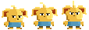](thronglet-anims/ThrongA_AngryAtPlayer_Spritesheet.png)                 |
| `ThrongA_DeepThought_Spritesheet`           | 3      |                        |                      |
| `ThrongA_ImpactfulExplanation_Spritesheet`  | 3      |                        |    |
| `ThrongA_LooktAtPlayerHappyNod_Spritesheet` | 10     |                        |  |
| `ThrongA_SkepticalToPlayer_Spritesheet`     | 3      |                        | [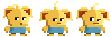](thronglet-anims/ThrongA_SkepticalToPlayer_Spritesheet.png)         |
| `ThrongA_Talk`                              | 6      | Console dialogue stare |                                                            |
| `ThrongA_TalkToOtherThronglet_Spritesheet2` | 3      |                        |  |
| `ThrongA_Talk_Blink_Spritesheet`            | 8      |                        |                        |
| `ThrongA_Talk_EarOffset_Spritesheet`        | 5      |                        |                |
| `ThrongA_Talk_EyeRoll_Spritesheet`          | 7      |                        |                    |
| `ThrongA_Talk_HandsBack_Spritesheet`        | 6      |                        |                |
| `ThrongA_Talk_Low_Spritesheet`              | 6      |                        |                            |
| `ThrongA_Talk_OffCenter`                    | 6      |                        | [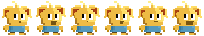](thronglet-anims/ThrongA_Talk_OffCenter.png)                                       |
| `ThrongA_Talk_ScratchArm_Spritesheet`       | 9      |                        |              |
| `ThrongA_Talk_Tall_Spritesheet`             | 6      |                        | [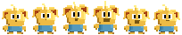](thronglet-anims/ThrongA_Talk_Tall_Spritesheet.png)                         |
| `ThrongB_TalkToOtherThronglet_Spritesheet2` | 3      |                        | [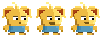](thronglet-anims/ThrongB_TalkToOtherThronglet_Spritesheet2.png) |
| `ThrongC_TalkToOtherThronglet_Spritesheet2` | 3      |                        |  |
| `ThrongD_TalkToOtherThronglet_Spritesheet2` | 3      |                        |  |
| `ThrongE_TalkToOtherThronglet_Spritesheet`  | 3      |                        |    |
| `ThrongE_TalkToOtherThronglet_Spritesheet2` | 3      |                        |  |

### Lifecycle / critical

| Clip                                          | Frames | Situation                    | Strip                                                                                                                                        |
| --------------------------------------------- | -----: | ---------------------------- | -------------------------------------------------------------------------------------------------------------------------------------------- |
| `ThrongA_Bones`                               | 1      | Death pop / bones            |                                                              |
| `ThrongA_Dead_001`                            | 1      | Corpse facing +dir_x         |                                                        |
| `ThrongA_Dead_002`                            | 1      | Corpse facing -dir_x         |                                                        |
| `ThrongA_MitosisCutscene_NoBlood_Spritesheet` | 34     | Alternate mitosis (no blood) | [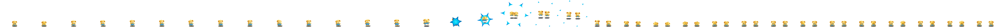](thronglet-anims/ThrongA_MitosisCutscene_NoBlood_Spritesheet.png) |
| `ThrongA_Mitosis_Spritesheet`                 | 36     | Charge → split (blocking)    | [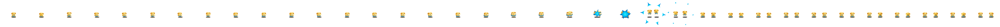](thronglet-anims/ThrongA_Mitosis_Spritesheet.png)                                 |
| `Throng_Egg_A`                                | 1      |                              |                                                                |
| `Throng_Egg_A_Glow`                           | 1      |                              |                                                      |
| `Throng_Egg_A_WiggleLeft`                     | 1      |                              |                                          |
| `Throng_Egg_A_WiggleRight`                    | 1      |                              |                                        |
| `Throng_Egg_B`                                | 1      |                              |                                                                |
| `Throng_Egg_B_Glow`                           | 1      |                              |                                                      |
| `Throng_Egg_B_WiggleLeft`                     | 1      |                              |                                          |
| `Throng_Egg_B_WiggleRight`                    | 1      |                              |                                        |
| `Throng_Egg_C`                                | 1      |                              |                                                                |
| `Throng_Egg_C_Empty`                          | 1      |                              |                                                    |
| `Throng_Egg_Sparkle_SpriteSheet2`             | 5      |                              |                          |
| `Throng_Prop_Blood_A`                         | 1      | Blood under corpse           |                                                  |

### Needs / mood

| Clip                     | Frames | Situation                     | Strip                                                                                              |
| ------------------------ | -----: | ----------------------------- | -------------------------------------------------------------------------------------------------- |
| `ThrongA_Bored_KickRock` | 14     | Boredom / trapped frustration |  |
| `ThrongA_Grumpy`         | 1      | Low amused static             |                  |
| `ThrongA_PuppyDogEyes`   | 4      | Low amused beg                |      |
| `ThrongA_Sad`            | 7      | Low fed or clean standing     | [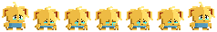](thronglet-anims/ThrongA_Sad.png)                       |
| `Throng_Grumpy3`         | 2      | Low amused loop               |                  |
| `Throng_Grumpy_Sheet`    | 3      | Low amused loop               |        |

### Interactions

| Clip                                | Frames | Situation                | Strip                                                                                                                    |
| ----------------------------------- | -----: | ------------------------ | ------------------------------------------------------------------------------------------------------------------------ |
| `ThrongA_Celebrate_Spritesheet`     | 9      | Milestone / unlock swarm | [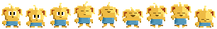](thronglet-anims/ThrongA_Celebrate_Spritesheet.png)         |
| `ThrongA_Eat`                       | 2      | ACT_EAT                  |                                              |
| `ThrongA_Jump_VariantA_Spritesheet` | 10     | ACT_PLAY free / theatre  |  |
| `ThrongA_Pickaxe_Spritesheet`       | 9      | ACT_WORK standing        | [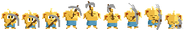](thronglet-anims/ThrongA_Pickaxe_Spritesheet.png)             |
| `ThrongA_Roundabout_SpriteSheet`    | 8      | Carousel seat            | [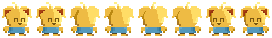](thronglet-anims/ThrongA_Roundabout_SpriteSheet.png)       |
| `ThrongA_Shrug`                     | 4      | Dialogue shrug           |                                          |
| `Throng_FallInBath_Spritesheet`     | 8      | Bath enter 0–4, soak 5–7 | [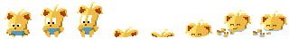](thronglet-anims/Throng_FallInBath_Spritesheet.png)         |

### Idle / autonomous

| Clip                                             | Frames | Situation                   | Strip                                                                                                                                              |
| ------------------------------------------------ | -----: | --------------------------- | -------------------------------------------------------------------------------------------------------------------------------------------------- |
| `ThrongA_Default`                                | 1      | Neutral stand               |                                                                |
| `ThrongA_Default Blink`                          | 1      | Blink one-shot              |                                                    |
| `ThrongA_EarWiggleLow`                           | 8      | Idle ear wiggle             |                                                      |
| `ThrongA_EarWiggleStand`                         | 4      | Idle ear wiggle stand       |                                                  |
| `ThrongA_Happy`                                  | 5      | Content / wash / empty bath |                                                                    |
| `ThrongA_Jump`                                   | 1      |                             |                                                                      |
| `ThrongA_Jump-EarWiggle`                         | 5      |                             |                                                  |
| `ThrongA_JumpBlink`                              | 1      |                             |                                                            |
| `ThrongA_Jump_High`                              | 1      |                             |                                                            |
| `ThrongA_Sophisticated`                          | 1      |                             |                                                    |
| `ThrongA_Squint`                                 | 3      |                             |                                                                  |
| `Throng_Idle_AntennaSpin_EyesClosed_Spritesheet` | 4      | Sleep / rest                |  |
| `Throng_Idle_AntennaSpin_Spritesheet`            | 4      | Idle antenna loop           |                        |
| `Throng_Idle_BackTurned`                         | 1      | Facing away idle            |                                                  |
| `Throng_Idle_EarsUp`                             | 1      | Alert ears                  |                                                          |
| `Throng_Idle_EyesDirection_Spritesheet`          | 8      | Look around                 |                    |
| `Throng_SarcasticSquint2`                        | 3      |                             |                                                |
| `Throng_SarcasticSquint3`                        | 2      |                             |                                                |
| `Throng_Sophisticated2`                          | 3      |                             |                                                    |
| `Throng_Sophisticated3`                          | 2      |                             |                                                    |
| `Throng_Think_Spritesheet`                       | 5      |                             |                                              |
| `Throng_Think_TwiddleThumbs_Spritesheet`         | 7      |                             |                  |
| `ThrongA_Default_Ghost`                          | 1      | Ghost / echo idle           | [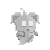](thronglet-anims/ThrongA_Default_Ghost.png)                                                   |

### Possessed / react

| Clip                                            | Frames | Situation                              | Strip                                                                                                                                            |
| ----------------------------------------------- | -----: | -------------------------------------- | ------------------------------------------------------------------------------------------------------------------------------------------------ |
| `ThrongA_Possessed_AntennaSpinEar_Spritesheet`  | 6      | Glitch talk                            |    |
| `ThrongA_Possessed_AntennaSpinTalk_Spritesheet` | 6      | Glitch talk                            |  |
| `ThrongA_Possessed_AntennaSpin_Spritesheet`     | 6      | Glitch talk                            | [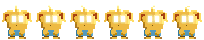](thronglet-anims/ThrongA_Possessed_AntennaSpin_Spritesheet.png)         |
| `ThrongA_Possessed_EarRaise_Spritesheet`        | 6      | Glitch talk                            | [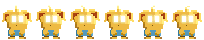](thronglet-anims/ThrongA_Possessed_EarRaise_Spritesheet.png)               |
| `ThrongA_ReactToKill`                           | 6      | Neighbor reacts to death               |                                                      |
| `ThrongA_PanicRun`                              | 4      | Penned / panic                         | [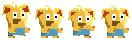](thronglet-anims/ThrongA_PanicRun.png)                                                           |
| `ThrongA_PanicRunFire`                          | 4      | Near fire                              |                                                    |
| `ThrongA_FreakOut`                              | 12     | Penned body                            |                                                            |
| `ThrongA_InAwe`                                 | 4      | Dialogue react                         |                                                                  |
| `ThrongA_Deflesh`                               | 24     | Packed; kill path stays Dead (see N/A) |                                                              |

### Locomotion

| Clip                               | Frames | Situation                    | Strip                                                                                                                  |
| ---------------------------------- | -----: | ---------------------------- | ---------------------------------------------------------------------------------------------------------------------- |
| `ThrongA_Rotund_Spritesheet`       | 4      | Asset only — **not wired** (no video) |              |
| `ThrongA_Happy_Walk`               | 2      | Content walk                 |                              |
| `ThrongA_Sad_Walk`                 | 2      | Hungry/dirty walk            | [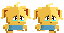](thronglet-anims/ThrongA_Sad_Walk.png)                                 |
| `ThrongA_LiftProp`                 | 7      | Carry stand                  | [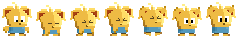](thronglet-anims/ThrongA_LiftProp.png)                                 |
| `ThrongA_LiftPropWalk`             | 2      | Carry walk                   |                          |
| `ThrongA_DropProp`                 | 4      | Carry drop (sheet packed)    |                                  |
| `ThrongA_Step01`                   | 1      |                              |                                      |
| `ThrongA_Step01_noface`            | 1      |                              |                        |
| `ThrongA_Step02`                   | 1      |                              |                                      |
| `ThrongA_Step02_noface`            | 1      |                              |                        |
| `Throng_Anim_Flying_Spritesheet`   | 9      |                              |      |
| `Throng_WalkBack_Anim_Spritesheet` | 5      | Move away                    | [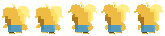](thronglet-anims/Throng_WalkBack_Anim_Spritesheet.png) |
| `Throng_Walk_Anim_Spritesheet`     | 5      | Move forward / side          |          |
| `Throng_Walk_Homed_Spritesheet`    | 5      | Walk to dwelling             | [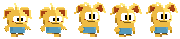](thronglet-anims/Throng_Walk_Homed_Spritesheet.png)       |

### Sing

| Clip                                   | Frames | Situation | Strip                                                                                                                          |
| -------------------------------------- | -----: | --------- | ------------------------------------------------------------------------------------------------------------------------------ |
| `ThrongA_SingToThronglet_Spritesheet2` | 6      |           |  |
| `ThrongB_SingToThronglet_Spritesheet2` | 8      |           | [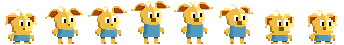](thronglet-anims/ThrongB_SingToThronglet_Spritesheet2.png) |
| `ThrongC_SingToThronglet_Spritesheet2` | 8      |           |  |
| `ThrongD_SingToThronglet_Spritesheet2` | 9      |           |  |
| `ThrongE_SingToThronglet_Spriesheet2`  | 8      |           | [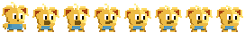](thronglet-anims/ThrongE_SingToThronglet_Spriesheet2.png)   |
| `Throng_SingB_Spritesheet`             | 8      |           | [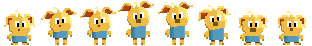](thronglet-anims/Throng_SingB_Spritesheet.png)                         |
| `Throng_SingC_Spritesheet`             | 9      |           |                          |
| `Throng_SingD_Spritesheet`             | 9      |           |                          |
| `Throng_SingE_Spritesheet`             | 8      |           |                          |
| `Throng_Sing_Spritesheet`              | 6      |           |                            |

### Eggs / props / outline

| Clip                     | Frames | Situation | Strip                                                                                              |
| ------------------------ | -----: | --------- | -------------------------------------------------------------------------------------------------- |
| `Throng_Prop_Shadow_A`   | 1      |           |      |
| `Throng_Prop_Shadow_A 1` | 1      |           |  |
| `Thronglet_Outline`      | 1      |           |            |
| `Throng_Outline`         | 1      |           |                  |

Situation pools live in `ThrongClips` (`IDLE_CALM`, `MOOD_*`, `SING_PEER`, `TALK_*`, `POSSESSED`, `CELEBRATE`, `PANIC`). There is no kitchen-sink `IDLE` dump.

## Strip gallery

### Talk / social / cutscene

#### `ThrongA_AngryAtPlayer_Spritesheet` (3f) — [ThrongA_AngryAtPlayer_Spritesheet.png](thronglet-anims/ThrongA_AngryAtPlayer_Spritesheet.png)

#### `ThrongA_DeepThought_Spritesheet` (3f) — [ThrongA_DeepThought_Spritesheet.png](thronglet-anims/ThrongA_DeepThought_Spritesheet.png)

#### `ThrongA_ImpactfulExplanation_Spritesheet` (3f) — [ThrongA_ImpactfulExplanation_Spritesheet.png](thronglet-anims/ThrongA_ImpactfulExplanation_Spritesheet.png)

#### `ThrongA_LooktAtPlayerHappyNod_Spritesheet` (10f) — [ThrongA_LooktAtPlayerHappyNod_Spritesheet.png](thronglet-anims/ThrongA_LooktAtPlayerHappyNod_Spritesheet.png)

#### `ThrongA_SkepticalToPlayer_Spritesheet` (3f) — [ThrongA_SkepticalToPlayer_Spritesheet.png](thronglet-anims/ThrongA_SkepticalToPlayer_Spritesheet.png)

#### `ThrongA_Talk` (6f) — [ThrongA_Talk.png](thronglet-anims/ThrongA_Talk.png)

#### `ThrongA_TalkToOtherThronglet_Spritesheet2` (3f) — [ThrongA_TalkToOtherThronglet_Spritesheet2.png](thronglet-anims/ThrongA_TalkToOtherThronglet_Spritesheet2.png)

#### `ThrongA_Talk_Blink_Spritesheet` (8f) — [ThrongA_Talk_Blink_Spritesheet.png](thronglet-anims/ThrongA_Talk_Blink_Spritesheet.png)

#### `ThrongA_Talk_EarOffset_Spritesheet` (5f) — [ThrongA_Talk_EarOffset_Spritesheet.png](thronglet-anims/ThrongA_Talk_EarOffset_Spritesheet.png)

#### `ThrongA_Talk_EyeRoll_Spritesheet` (7f) — [ThrongA_Talk_EyeRoll_Spritesheet.png](thronglet-anims/ThrongA_Talk_EyeRoll_Spritesheet.png)

#### `ThrongA_Talk_HandsBack_Spritesheet` (6f) — [ThrongA_Talk_HandsBack_Spritesheet.png](thronglet-anims/ThrongA_Talk_HandsBack_Spritesheet.png)

#### `ThrongA_Talk_Low_Spritesheet` (6f) — [ThrongA_Talk_Low_Spritesheet.png](thronglet-anims/ThrongA_Talk_Low_Spritesheet.png)

#### `ThrongA_Talk_OffCenter` (6f) — [ThrongA_Talk_OffCenter.png](thronglet-anims/ThrongA_Talk_OffCenter.png)

#### `ThrongA_Talk_ScratchArm_Spritesheet` (9f) — [ThrongA_Talk_ScratchArm_Spritesheet.png](thronglet-anims/ThrongA_Talk_ScratchArm_Spritesheet.png)

#### `ThrongA_Talk_Tall_Spritesheet` (6f) — [ThrongA_Talk_Tall_Spritesheet.png](thronglet-anims/ThrongA_Talk_Tall_Spritesheet.png)

#### `ThrongB_TalkToOtherThronglet_Spritesheet2` (3f) — [ThrongB_TalkToOtherThronglet_Spritesheet2.png](thronglet-anims/ThrongB_TalkToOtherThronglet_Spritesheet2.png)

#### `ThrongC_TalkToOtherThronglet_Spritesheet2` (3f) — [ThrongC_TalkToOtherThronglet_Spritesheet2.png](thronglet-anims/ThrongC_TalkToOtherThronglet_Spritesheet2.png)

#### `ThrongD_TalkToOtherThronglet_Spritesheet2` (3f) — [ThrongD_TalkToOtherThronglet_Spritesheet2.png](thronglet-anims/ThrongD_TalkToOtherThronglet_Spritesheet2.png)

#### `ThrongE_TalkToOtherThronglet_Spritesheet` (3f) — [ThrongE_TalkToOtherThronglet_Spritesheet.png](thronglet-anims/ThrongE_TalkToOtherThronglet_Spritesheet.png)

#### `ThrongE_TalkToOtherThronglet_Spritesheet2` (3f) — [ThrongE_TalkToOtherThronglet_Spritesheet2.png](thronglet-anims/ThrongE_TalkToOtherThronglet_Spritesheet2.png)

### Lifecycle / critical

#### `ThrongA_Bones` (1f) — [ThrongA_Bones.png](thronglet-anims/ThrongA_Bones.png)

#### `ThrongA_Dead_001` (1f) — [ThrongA_Dead_001.png](thronglet-anims/ThrongA_Dead_001.png)

#### `ThrongA_Dead_002` (1f) — [ThrongA_Dead_002.png](thronglet-anims/ThrongA_Dead_002.png)

#### `ThrongA_MitosisCutscene_NoBlood_Spritesheet` (34f) — [ThrongA_MitosisCutscene_NoBlood_Spritesheet.png](thronglet-anims/ThrongA_MitosisCutscene_NoBlood_Spritesheet.png)

#### `ThrongA_Mitosis_Spritesheet` (36f) — [ThrongA_Mitosis_Spritesheet.png](thronglet-anims/ThrongA_Mitosis_Spritesheet.png)

#### `Throng_Egg_A` (1f) — [Throng_Egg_A.png](thronglet-anims/Throng_Egg_A.png)

#### `Throng_Egg_A_Glow` (1f) — [Throng_Egg_A_Glow.png](thronglet-anims/Throng_Egg_A_Glow.png)

#### `Throng_Egg_A_WiggleLeft` (1f) — [Throng_Egg_A_WiggleLeft.png](thronglet-anims/Throng_Egg_A_WiggleLeft.png)

#### `Throng_Egg_A_WiggleRight` (1f) — [Throng_Egg_A_WiggleRight.png](thronglet-anims/Throng_Egg_A_WiggleRight.png)

#### `Throng_Egg_B` (1f) — [Throng_Egg_B.png](thronglet-anims/Throng_Egg_B.png)

#### `Throng_Egg_B_Glow` (1f) — [Throng_Egg_B_Glow.png](thronglet-anims/Throng_Egg_B_Glow.png)

#### `Throng_Egg_B_WiggleLeft` (1f) — [Throng_Egg_B_WiggleLeft.png](thronglet-anims/Throng_Egg_B_WiggleLeft.png)

#### `Throng_Egg_B_WiggleRight` (1f) — [Throng_Egg_B_WiggleRight.png](thronglet-anims/Throng_Egg_B_WiggleRight.png)

#### `Throng_Egg_C` (1f) — [Throng_Egg_C.png](thronglet-anims/Throng_Egg_C.png)

#### `Throng_Egg_C_Empty` (1f) — [Throng_Egg_C_Empty.png](thronglet-anims/Throng_Egg_C_Empty.png)

#### `Throng_Egg_Sparkle_SpriteSheet2` (5f) — [Throng_Egg_Sparkle_SpriteSheet2.png](thronglet-anims/Throng_Egg_Sparkle_SpriteSheet2.png)

#### `Throng_Prop_Blood_A` (1f) — [Throng_Prop_Blood_A.png](thronglet-anims/Throng_Prop_Blood_A.png)

### Needs / mood

#### `ThrongA_Bored_KickRock` (14f) — [ThrongA_Bored_KickRock.png](thronglet-anims/ThrongA_Bored_KickRock.png)

#### `ThrongA_Grumpy` (1f) — [ThrongA_Grumpy.png](thronglet-anims/ThrongA_Grumpy.png)

#### `ThrongA_Sad` (7f) — [ThrongA_Sad.png](thronglet-anims/ThrongA_Sad.png)

#### `Throng_Grumpy3` (2f) — [Throng_Grumpy3.png](thronglet-anims/Throng_Grumpy3.png)

#### `Throng_Grumpy_Sheet` (3f) — [Throng_Grumpy_Sheet.png](thronglet-anims/Throng_Grumpy_Sheet.png)

### Interactions

#### `ThrongA_Celebrate_Spritesheet` (9f) — [ThrongA_Celebrate_Spritesheet.png](thronglet-anims/ThrongA_Celebrate_Spritesheet.png)

#### `ThrongA_Eat` (2f) — [ThrongA_Eat.png](thronglet-anims/ThrongA_Eat.png)

#### `ThrongA_Jump_VariantA_Spritesheet` (10f) — [ThrongA_Jump_VariantA_Spritesheet.png](thronglet-anims/ThrongA_Jump_VariantA_Spritesheet.png)

#### `ThrongA_Pickaxe_Spritesheet` (9f) — [ThrongA_Pickaxe_Spritesheet.png](thronglet-anims/ThrongA_Pickaxe_Spritesheet.png)

#### `ThrongA_Roundabout_SpriteSheet` (8f) — [ThrongA_Roundabout_SpriteSheet.png](thronglet-anims/ThrongA_Roundabout_SpriteSheet.png)

#### `ThrongA_Shrug` (4f) — [ThrongA_Shrug.png](thronglet-anims/ThrongA_Shrug.png)

#### `Throng_FallInBath_Spritesheet` (8f) — [Throng_FallInBath_Spritesheet.png](thronglet-anims/Throng_FallInBath_Spritesheet.png)

### Idle / autonomous

#### `ThrongA_Default` (1f) — [ThrongA_Default.png](thronglet-anims/ThrongA_Default.png)

#### `ThrongA_Default Blink` (1f) — [ThrongA_Default_Blink.png](thronglet-anims/ThrongA_Default_Blink.png)

#### `ThrongA_EarWiggleLow` (8f) — [ThrongA_EarWiggleLow.png](thronglet-anims/ThrongA_EarWiggleLow.png)

#### `ThrongA_EarWiggleStand` (4f) — [ThrongA_EarWiggleStand.png](thronglet-anims/ThrongA_EarWiggleStand.png)

#### `ThrongA_Happy` (5f) — [ThrongA_Happy.png](thronglet-anims/ThrongA_Happy.png)

#### `ThrongA_Jump` (1f) — [ThrongA_Jump.png](thronglet-anims/ThrongA_Jump.png)

#### `ThrongA_Jump-EarWiggle` (5f) — [ThrongA_Jump-EarWiggle.png](thronglet-anims/ThrongA_Jump-EarWiggle.png)

#### `ThrongA_JumpBlink` (1f) — [ThrongA_JumpBlink.png](thronglet-anims/ThrongA_JumpBlink.png)

#### `ThrongA_Jump_High` (1f) — [ThrongA_Jump_High.png](thronglet-anims/ThrongA_Jump_High.png)

#### `ThrongA_Sophisticated` (1f) — [ThrongA_Sophisticated.png](thronglet-anims/ThrongA_Sophisticated.png)

#### `ThrongA_Squint` (3f) — [ThrongA_Squint.png](thronglet-anims/ThrongA_Squint.png)

#### `Throng_Idle_AntennaSpin_EyesClosed_Spritesheet` (4f) — [Throng_Idle_AntennaSpin_EyesClosed_Spritesheet.png](thronglet-anims/Throng_Idle_AntennaSpin_EyesClosed_Spritesheet.png)

#### `Throng_Idle_AntennaSpin_Spritesheet` (4f) — [Throng_Idle_AntennaSpin_Spritesheet.png](thronglet-anims/Throng_Idle_AntennaSpin_Spritesheet.png)

#### `Throng_Idle_BackTurned` (1f) — [Throng_Idle_BackTurned.png](thronglet-anims/Throng_Idle_BackTurned.png)

#### `Throng_Idle_EarsUp` (1f) — [Throng_Idle_EarsUp.png](thronglet-anims/Throng_Idle_EarsUp.png)

#### `Throng_Idle_EyesDirection_Spritesheet` (8f) — [Throng_Idle_EyesDirection_Spritesheet.png](thronglet-anims/Throng_Idle_EyesDirection_Spritesheet.png)

#### `Throng_SarcasticSquint2` (3f) — [Throng_SarcasticSquint2.png](thronglet-anims/Throng_SarcasticSquint2.png)

#### `Throng_SarcasticSquint3` (2f) — [Throng_SarcasticSquint3.png](thronglet-anims/Throng_SarcasticSquint3.png)

#### `Throng_Sophisticated2` (3f) — [Throng_Sophisticated2.png](thronglet-anims/Throng_Sophisticated2.png)

#### `Throng_Sophisticated3` (2f) — [Throng_Sophisticated3.png](thronglet-anims/Throng_Sophisticated3.png)

#### `Throng_Think_Spritesheet` (5f) — [Throng_Think_Spritesheet.png](thronglet-anims/Throng_Think_Spritesheet.png)

#### `Throng_Think_TwiddleThumbs_Spritesheet` (7f) — [Throng_Think_TwiddleThumbs_Spritesheet.png](thronglet-anims/Throng_Think_TwiddleThumbs_Spritesheet.png)

#### `ThrongA_Default_Ghost` (1f) — [ThrongA_Default_Ghost.png](thronglet-anims/ThrongA_Default_Ghost.png)

### Possessed / react

#### `ThrongA_Possessed_AntennaSpinEar_Spritesheet` (6f) — [ThrongA_Possessed_AntennaSpinEar_Spritesheet.png](thronglet-anims/ThrongA_Possessed_AntennaSpinEar_Spritesheet.png)

#### `ThrongA_Possessed_AntennaSpinTalk_Spritesheet` (6f) — [ThrongA_Possessed_AntennaSpinTalk_Spritesheet.png](thronglet-anims/ThrongA_Possessed_AntennaSpinTalk_Spritesheet.png)

#### `ThrongA_Possessed_AntennaSpin_Spritesheet` (6f) — [ThrongA_Possessed_AntennaSpin_Spritesheet.png](thronglet-anims/ThrongA_Possessed_AntennaSpin_Spritesheet.png)

#### `ThrongA_Possessed_EarRaise_Spritesheet` (6f) — [ThrongA_Possessed_EarRaise_Spritesheet.png](thronglet-anims/ThrongA_Possessed_EarRaise_Spritesheet.png)

#### `ThrongA_ReactToKill` (6f) — [ThrongA_ReactToKill.png](thronglet-anims/ThrongA_ReactToKill.png)

### Locomotion

#### `ThrongA_Rotund_Spritesheet` (4f) — asset only, **not wired** — [ThrongA_Rotund_Spritesheet.png](thronglet-anims/ThrongA_Rotund_Spritesheet.png)

No playthrough frame shows this after eating ([4:30](video-frames/t004-30.jpg)–[4:40](video-frames/t004-40.jpg), [68:03](video-frames/t068-03.jpg) stay normal/`Happy`). Sheet kept packed; no `rotund_t`.

#### `ThrongA_Step01` (1f) — [ThrongA_Step01.png](thronglet-anims/ThrongA_Step01.png)

#### `ThrongA_Step01_noface` (1f) — [ThrongA_Step01_noface.png](thronglet-anims/ThrongA_Step01_noface.png)

#### `ThrongA_Step02` (1f) — [ThrongA_Step02.png](thronglet-anims/ThrongA_Step02.png)

#### `ThrongA_Step02_noface` (1f) — [ThrongA_Step02_noface.png](thronglet-anims/ThrongA_Step02_noface.png)

#### `Throng_Anim_Flying_Spritesheet` (9f) — [Throng_Anim_Flying_Spritesheet.png](thronglet-anims/Throng_Anim_Flying_Spritesheet.png)

#### `Throng_WalkBack_Anim_Spritesheet` (5f) — [Throng_WalkBack_Anim_Spritesheet.png](thronglet-anims/Throng_WalkBack_Anim_Spritesheet.png)

#### `Throng_Walk_Anim_Spritesheet` (5f) — [Throng_Walk_Anim_Spritesheet.png](thronglet-anims/Throng_Walk_Anim_Spritesheet.png)

#### `Throng_Walk_Homed_Spritesheet` (5f) — [Throng_Walk_Homed_Spritesheet.png](thronglet-anims/Throng_Walk_Homed_Spritesheet.png)

### Sing

#### `ThrongA_SingToThronglet_Spritesheet2` (6f) — [ThrongA_SingToThronglet_Spritesheet2.png](thronglet-anims/ThrongA_SingToThronglet_Spritesheet2.png)

#### `ThrongB_SingToThronglet_Spritesheet2` (8f) — [ThrongB_SingToThronglet_Spritesheet2.png](thronglet-anims/ThrongB_SingToThronglet_Spritesheet2.png)

#### `ThrongC_SingToThronglet_Spritesheet2` (8f) — [ThrongC_SingToThronglet_Spritesheet2.png](thronglet-anims/ThrongC_SingToThronglet_Spritesheet2.png)

#### `ThrongD_SingToThronglet_Spritesheet2` (9f) — [ThrongD_SingToThronglet_Spritesheet2.png](thronglet-anims/ThrongD_SingToThronglet_Spritesheet2.png)

#### `ThrongE_SingToThronglet_Spriesheet2` (8f) — [ThrongE_SingToThronglet_Spriesheet2.png](thronglet-anims/ThrongE_SingToThronglet_Spriesheet2.png)

#### `Throng_SingB_Spritesheet` (8f) — [Throng_SingB_Spritesheet.png](thronglet-anims/Throng_SingB_Spritesheet.png)

#### `Throng_SingC_Spritesheet` (9f) — [Throng_SingC_Spritesheet.png](thronglet-anims/Throng_SingC_Spritesheet.png)

#### `Throng_SingD_Spritesheet` (9f) — [Throng_SingD_Spritesheet.png](thronglet-anims/Throng_SingD_Spritesheet.png)

#### `Throng_SingE_Spritesheet` (8f) — [Throng_SingE_Spritesheet.png](thronglet-anims/Throng_SingE_Spritesheet.png)

#### `Throng_Sing_Spritesheet` (6f) — [Throng_Sing_Spritesheet.png](thronglet-anims/Throng_Sing_Spritesheet.png)

### Eggs / props / outline

#### `Throng_Prop_Shadow_A` (1f) — [Throng_Prop_Shadow_A.png](thronglet-anims/Throng_Prop_Shadow_A.png)

#### `Throng_Prop_Shadow_A 1` (1f) — [Throng_Prop_Shadow_A_1.png](thronglet-anims/Throng_Prop_Shadow_A_1.png)

#### `Thronglet_Outline` (1f) — [Thronglet_Outline.png](thronglet-anims/Thronglet_Outline.png)

#### `Throng_Outline` (1f) — [Throng_Outline.png](thronglet-anims/Throng_Outline.png)

outline |

Situation pools live in `ThrongClips` (`IDLE_CALM`, `MOOD_*`, `SING_PEER`, `TALK_*`, `POSSESSED`, `CELEBRATE`, `PANIC`). There is no kitchen-sink `IDLE` dump.

## Unity-only sheets (not in runtime atlas)

Present under `references/Assets/Sprite/` but **missing** from `ThrongClips.CLIPS`. Needed for fidelity when atlas extraction lands:

| Unity prefix                                                                       | Frames (approx) | Situation                                                       |
| ---------------------------------------------------------------------------------- | --------------: | --------------------------------------------------------------- |
| `Char_ThrongA_PanicRun` (+ Alpha)                                                  | 4 (+4)          | Penned / frightened pacing                                      |
| `Char_ThrongA_PanicRunFire`                                                        | 4               | Panic near fire                                                 |
| `Char_ThrongA_FreakOut` (+ Alpha)                                                  | 12              | Strong fright / trapped realization                             |
| `Char_ThrongA_LiftProp` → `LiftPropWalk` → `DropProp`                              | 7 → 2 → 4       | Haul crystals / ore on head ([73:30](video-frames/t073-30.jpg)) |
| `Char_ThrongA_Happy_Walk_Spritesheet`                                              | 2               | Content walk                                                    |
| `Char_ThrongA_Sad_Walk_Spritesheet`                                                | 2               | Low-need walk                                                   |
| `Char_ThrongA_PuppyDogEyes_Spritesheet`                                            | 4               | Pleading / low amused                                           |
| `Char_ThrongA_InAwe_Spritesheet`                                                   | 4               | Awe dialogue reaction                                           |
| `Char_ThrongA_Deflesh_1..24`                                                       | 24              | Extreme death / chainsaw path                                   |
| `UI_PollutionWarning_Thronglet_Spritesheet`                                        | 4               | Dirty warning overlay                                           |
| Captcha: `Bored`, `Panic`, `FreakedA–C`, `SadA/B`, `SingA–D`, `Dead`, `Mitosis`, … | 1 each          | Pose reference / captcha UI                                     |

Dirt body look also uses `..._DirtTex.png` (shader mask), not a clip.

## Video pose confirmation (key frames)

| Time   | Frame                               | Observed body language                                                                                                           |
| ------ | ----------------------------------- | -------------------------------------------------------------------------------------------------------------------------------- |
| 4:00   | [t004-00](video-frames/t004-00.jpg) | Two in wood pen: one eyes-closed (sleep/rest + green particles), one alert Default                                               s|
| 5:30   | [t005-30](video-frames/t005-30.jpg) | Sign `Uh oh! They've realised they're trapped`; open mouths, agitated stance among trees/rocks — **trapped/panic**, balls unused |
| 12:30  | [t012-30](video-frames/t012-30.jpg) | Bath soak (eyes closed in tubs); roundabout riders; pairs facing; speech bubble; back-turned idle                                s|
| 42:30  | [t042-30](video-frames/t042-30.jpg) | Console death talk: corpse face-down, X-eyes, blood; living thronglet beside it; bath + walk in world                            s|
| 68:00  | [t068-00](video-frames/t068-00.jpg) | Needs card: FED low, **AMUSED empty**, CLEAN empty; closed-eye stand by bitten apple + sparkles                                  s|
| 70:30  | [t070-30](video-frames/t070-30.jpg) | Dense town: walk, bath, face-to-face clusters, some **lying flat** (rest/sleep)                                                  s|
| 73:30  | [t073-30](video-frames/t073-30.jpg) | Head-carry haul; speed streaks; theatre-mask speech bubble; face-down rest; mining                                               s|
| 111:30 | [t111-30](video-frames/t111-30.jpg) | Late single thronglet, front idle during judgment dialogue + package inject                                                      s|
| 114:00 | [t114-00](video-frames/t114-00.jpg) | Same close-up idle while `ISOLATING AND TERMINATING…` — dialogue freeze context                                                  s|
| 121:30 | [t121-30](video-frames/t121-30.jpg) | Void gift: apple + bubble `We won't forget that.` — talk/reaction after gift                                                     s|

Sampling is every 30s; short one-shots (kick-rock mid-cycle, mitosis split, freak-out) rarely freeze mid-frame but exist in the sprite dump and moral report text (`watching them be frightened` at 31:30).

## Situation catalog

Columns: **situation** | **sim / game trigger** | **clips (order)** | **loop** | **tier** | **video**

### Base / needs (tier 1)

| Situation            | Trigger                                                     | Clips (order)                                                                                                                            | Loop                               | Video                                                                                |
| -------------------- | ----------------------------------------------------------- | ---------------------------------------------------------------------------------------------------------------------------------------- | ---------------------------------- | ------------------------------------------------------------------------------------ |
| Neutral idle         | Living, not moving, needs mid, not penned                   | `Default` → rotate `Default Blink`, `Idle_AntennaSpin`, `Idle_EarsUp`, `Idle_EyesDirection`, `Idle_BackTurned`, `EarWiggleLow` / `Stand` | yes (hold ~2–3s per clip)          | Ubiquitous; [4:00](video-frames/t004-00.jpg)                                         |
| Sleep / rest         | Low activity or night-like rest; lying flat                 | `Idle_AntennaSpin_EyesClosed`                                                                                                            | yes                                | [4:00](video-frames/t004-00.jpg), [70:30](video-frames/t070-30.jpg)                  |
| Walk                 | `moving`, not back-dominant                                 | `Walk_Anim`                                                                                                                              | yes                                | [70:30](video-frames/t070-30.jpg), [73:30](video-frames/t073-30.jpg)                 |
| Walk back            | `moving` and `|dir_y| > |dir_x|` and `dir_y < 0`            | `WalkBack_Anim`                                                                                                                          | yes                                | [12:30](video-frames/t012-30.jpg) back-facing                                        |
| Walk homed           | Visiting / assigned dwelling path                           | `Walk_Homed`                                                                                                                             | yes                                | Asset; indoor guests currently hidden                                                |
| Happy walk           | Moving and all needs ≥ `NEED_OK`                            | Unity `Happy_Walk` when extracted; else Walk                                                                                             | yes                                | Town clusters                                                                        |
| Sad walk             | Moving and (fed<25 or clean<12)                             | Unity `Sad_Walk` when extracted; else Walk + Sad when stopped                                                                            | yes                                | —                                                                                    |
| Hungry / dirty stand | Standing and (`fed < 25` or `clean < 12`)                   | `Sad` + DirtTex mix from `clean`                                                                                                         | yes                                | Needs HUD [68:00](video-frames/t068-00.jpg)                                          |
| Bored / low fun      | Standing and `amused < 25`                                  | `Bored_KickRock` (primary) → `Grumpy_Sheet` / `Grumpy3` / `PuppyDogEyes`                                                                 | KickRock one-shot then loop grumpy | AMUSED empty [68:00](video-frames/t068-00.jpg); captcha Bored                        |
| Content calm         | Standing, needs OK, not singing                             | Calm pool **only**: Default, Blink, Happy, EarWiggleLow, Think, Shrug (light) — **no** KickRock / Celebrate / Ghost                      | yes                                | Content town                                                                         |
| Bark sing            | Active thought bark **and** `bark_can_sing` (not bath/theatre/carry/act…) | Random one of `SingB` / `SingC` / `SingD` / `SingE` for that bark                                      | yes while bark                     | Bocadillo + sing mouth [12:30](video-frames/t012-30.jpg)                             |
| Peer sing            | Needs all ≥ `NEED_OK` **and** near another living thronglet | `Sing` / `SingB`–`E` → optional `SingToThronglet` A–E                                                                      | yes                                | Facing clusters [12:30](video-frames/t012-30.jpg), [70:30](video-frames/t070-30.jpg) |
| Peer talk            | Near peer, social tick (not console)                        | `TalkToOtherThronglet` A–E                                                                                                               | yes (short 3f)                     | Pairs [12:30](video-frames/t012-30.jpg)                                              |
| Penned / no exit     | `_is_penned` (≥6 blocked dirs)                              | Prefer Unity `FreakOut` / `PanicRun` when atlas has them; until then Walk pacing + keep `ICON_ROCK` bark — **not** calm idle             | panic loop / pacing                | [5:30](video-frames/t005-30.jpg)                                                     |

### Direct interaction (tier 2)

| Situation           | Trigger                                | Clips (order)                                        | Loop                 | Video                                                                              |
| ------------------- | -------------------------------------- | ---------------------------------------------------- | -------------------- | ---------------------------------------------------------------------------------- |
| Eat                 | `ACT_EAT`                              | `Eat` @ ~6fps while biting; on bite land → idle (`Happy` / calm) | Eat loop while act   | Bite [4:30](video-frames/t004-30.jpg), [68:00](video-frames/t068-00.jpg)–[68:04](video-frames/t068-04.jpg); post-bite Happy [68:03](video-frames/t068-03.jpg) |
| Bath enter          | `ACT_BATH`, seat, `age < BATH_ENTER_T` | `FallInBath` frames 0–4 along enter                  | one-shot             | [12:30](video-frames/t012-30.jpg)                                                  |
| Bath soak           | `ACT_BATH`, after enter                | `FallInBath` 5–7                                     | yes                  | [12:30](video-frames/t012-30.jpg), [42:30](video-frames/t042-30.jpg)               |
| Bath no seat        | `ACT_BATH`, empty tub dict             | `Happy`                                              | yes                  | —                                                                                  |
| Wash / sponge       | Press over dirty; **agitate** (`stroke >= 0.35`) | Hold still after first stroke → `Happy` + suds; rub → clean gain; release after 100% → one `CLEAN` + `Happy` | suds while sponge held on wash target | [4:42](video-frames/t004-42.jpg); shot `wash_scrub_vs_sparkle.png` |
| Ball play move      | `ACT_PLAY` + ball + moving             | Walk / WalkBack                                      | yes                  | Balls from [4:30](video-frames/t004-30.jpg)                                        |
| Ball play idle      | `ACT_PLAY` + ball + still              | `Happy`                                              | yes                  | —                                                                                  |
| Roundabout          | `ACT_PLAY` + ride seat                 | `Roundabout` frame from seat angle                   | yes (pose by angle)  | [9:30] unlock, [12:30](video-frames/t012-30.jpg)                                   |
| Free play / theatre | `ACT_PLAY`, no ball/ride               | `Jump_VariantA`                                      | yes                  | Theatre [59:00](video-frames/t059-00.jpg); masks [73:30](video-frames/t073-30.jpg) |
| Mine work           | `ACT_WORK` + mining guest + swing beat | `Pickaxe`                                            | yes (swing window)   | Ore nodes; pickaxe refs                                                            |
| Work wait           | Same guest, wait beat after swing      | `Think_TwiddleThumbs`                                | yes (wait window)    | FULL nodes [73:30](video-frames/t073-30.jpg)                                       |
| Carry haul          | `carry != NONE`                        | `LiftProp` / `LiftPropWalk`                          | yes                  | [73:30](video-frames/t073-30.jpg) crystals on heads                                |
| Carry drop          | `_set_carry` → NONE (`drop_t`)         | `DropProp` along drop window                         | one-shot             | Deliver / drop haul                                                                |

### Critical (tier 3)

| Situation      | Trigger                                  | Clips (order)                                                             | Loop            | Video                                                                 |
| -------------- | ---------------------------------------- | ------------------------------------------------------------------------- | --------------- | --------------------------------------------------------------------- |
| Mitosis charge | `mito_charge > 0`, `mito_t == 0`         | `Mitosis_Spritesheet` along `0 … MITOSIS_SPLIT_ALONG`                     | progress        | Growth counters                                                       |
| Mitosis split  | `mito_t > 0`                             | Same sheet along `MITOSIS_SPLIT_ALONG … 0.999`; spawn child on last frame | one-shot 0.45s  | Asset 36f; captcha Mitosis                                            |
| Death          | `ST_DEAD`                                | `Dead_001` or `_002` by facing; optional `Blood` prop; `Bones` pop        | hold            | [42:30](video-frames/t042-30.jpg), [104:00](video-frames/t104-00.jpg) |
| Deflesh        | Extreme kill tool path                   | Unity `Deflesh_1..24` when extracted                                      | one-shot        | Report chainsaw kills                                                 |
| React to kill  | Living thronglet in range of a new death | `ReactToKill` once → return to prior                                      | one-shot        | Living beside corpse [42:30](video-frames/t042-30.jpg)                |
| Panic fire     | Near `FEAT_FIRE`                         | Unity `PanicRunFire` or PanicRun                                          | yes until clear | Thought `ICON_FIRE` today                                             |
| Egg hatch      | Egg entity                               | Wiggle L/R → Glow → Sparkle → Empty; or prop `EGG_ANIM` path              | sequence        | Tutorial egg stretch                                                  |

### Cutscene (tier 4)

| Situation                | Trigger                            | Clips (order)                                                                                                                              | Loop                    | Video                                                                                    |
| ------------------------ | ---------------------------------- | ------------------------------------------------------------------------------------------------------------------------------------------ | ----------------------- | ---------------------------------------------------------------------------------------- |
| Dialogue stare           | Console / talk modal (`frozen`)    | Freeze AI → stagger 0–300ms → pool: `Talk`, Talk_Blink, HandsBack, ScratchArm, EyeRoll, Tall, Low, OffCenter, EarOffset                    | yes while modal         | All console talks; [42:30](video-frames/t042-30.jpg), [111:30](video-frames/t111-30.jpg) |
| Dialogue reaction (tone) | Tagged line mood                   | After or instead of base talk: HappyNod / Skeptical / Angry / DeepThought / ImpactfulExplanation / Shrug / InAwe                           | one-shot then talk loop | Gift line [121:30](video-frames/t121-30.jpg); angry judgment beats                       |
| Unlock celebrate         | Milestone / unlock card            | Swarm `Celebrate` only                                                                                                                     | one-shot wave           | Mid-air hop [0:30](video-frames/t000-30.jpg)                                             |
| Possessed / glitch talk  | `frozen` **and** `glitch_t > 0.45` (monolith; not every gaze) | `Possessed_*` pool                                                                                                            | yes while glitch        | Body stays Default during package inject ([111:30](video-frames/t111-30.jpg)–[114:00](video-frames/t114-00.jpg)); possessed only with real `glitch_t` |
| Group sing cutscene      | Scripted SEQ / hive song           | Sing A–E + SingToThronglet A–E                                                                                                             | yes                     | Asset; group frames                                                                      |

## Mismatch table (shipped vs remaining)

Source of truth: [`Main._frame`](../scripts/presentation/Main.gd) + situation pools in [`throng_clips.gd`](../scripts/data/throng_clips.gd). High/Medium rows from the R&D pass are **fixed** in this delivery unless marked N/A.

| Behavior | Status | Notes |
| --- | --- | --- |
| Calm idle no longer mixes KickRock / Celebrate / Jump / Ghost | Done | `IDLE_CALM` only |
| `amused < 25` → `MOOD_BORED` (KickRock / Grumpy sheets / PuppyDogEyes) | Done | |
| Penned → `FreakOut` + rock bark | Done | `penned_flag`; `PanicRun` sheet packed unused |
| Frozen → `TALK_CONSOLE` (+ `TALK_REACT` mood accents); Possessed only when `glitch_t` | Done | `_begin_gaze` no longer forces `glitch_t` ([111:30](video-frames/t111-30.jpg) Default) |
| Sing only when content **and** near peer | Done | `has_living_peer` |
| `Walk_Homed` on dwelling approach | Done | `approaching_home` |
| Antenna / eyes / back / sleep in calm / sleep pools | Done | `IDLE_SLEEP` via `sleep_t` |
| `ReactToKill` on nearby death | Done | `react_t` |
| Swarm Celebrate on unlock (`celebrate_t`) | Done | No eat `cheer_t`; Rotund unwired |
| Carry / Happy\|Sad walk / Puppy / InAwe in atlas + wired | Done | Packed cells 654–722 |
| Situation pools replace kitchen-sink idle | Done | No `ThrongClips.IDLE` |
| Sing D/E + SingToThronglet B–E in `SING_PEER` | Done | |
| Deflesh on extreme kill tools | **N/A** | Sheet packed; kill tools still map to `Dead_001/002` |
| Theatre mask overlay on body | **N/A** | Bubble UI only ([73:30](video-frames/t073-30.jpg)); guests hidden indoors |
| Pollution UI sheet | **N/A (optional)** | DirtTex shader |
| `Rotund` / eat→Celebrate / Jump accents live | **Removed** | No video for post-feed Rotund/Celebrate; Jump accents shots-only |

### Wiring audit (2026-11-23 playthrough)

| Verdict | Situations |
| --- | --- |
| **OK** | Death, Eat, Bath soak/enter, Roundabout, Carry haul, Penned→FreakOut, Base walk, Sad stand, Default/calm idle, Wash→Happy, Unlock Celebrate |
| **WEAK** (wired, pose not crisp in frames) | TALK_CONSOLE variants, TALK_REACT, peer sing/talk, Happy/Sad/Homed walks, free-play Jump, Pickaxe/Twiddle, DropProp, Mitosis, PanicRunFire, Bored KickRock, Sleep eyes-closed, ball play |
| **INVENTED → fixed** | Post-feed Rotund; eat `cheer_t`→Celebrate; every gaze → POSSESSED via `_begin_gaze` glitch |
| **Asset / not live** | Rotund, Deflesh, PanicRun (penned uses FreakOut), Jump / Jump-EarWiggle (not mixed into unlock), Ghost, Flying, Theatre body mask |

### What is situation-correct

Dead facing, mitosis along charge/split, Eat then Happy idle (not Celebrate/Rotund), FallInBath phases, Wash→Happy, ball Walk/Happy, Roundabout by angle, Jump_VariantA free play, Pickaxe when working still, Walk/WalkBack/Homed/mood walks, carry LiftProp*, Sad/Bored pools, peer sing/talk, console stare (Default/Talk — Possessed only with real `glitch_t`), penned FreakOut / fire PanicRunFire, unlock celebrate, sleep eyes-closed.

## Cinematic sequences (ordered)

### 1. Tutorial care (early enclosure)

Evidence: [3:00](video-frames/t003-00.jpg)–[6:30](video-frames/t006-30.jpg), wood frame [4:00](video-frames/t004-00.jpg), trapped [5:30](video-frames/t005-30.jpg).

1. Spawn / idle: `Default` (+ Blink).
2. Dirty prompt: DirtTex up; optional green sparkle FX; player sponge → `ACT_WASH` → `Happy` + soap FX.
3. Feed: `ACT_EAT` → `Eat` → idle/`Happy` (closed eyes; [68:03](video-frames/t068-03.jpg)).
4. Ball: `ACT_PLAY` → Walk/Happy with ball.
5. If still enclosed and `_is_penned`: FreakOut/PanicRun (or pacing) + rock bark; sign beat in original.
6. Mitosis when needs recover: charge → `Mitosis_Spritesheet` → split on final frame.

Suggested tool order (from video-gaps checklist): apple → ball → sponge → mitosis sign progression.

### 2. Dialogue stare (`triggerDialogueStare`)

1. Talk modal opens → `frozen = true` (already ~6020 in sim).
2. All living thronglets: pause seek; stagger start 0–300 ms by index.
3. Play **console talk pool** only: `Talk`, Talk_Blink, HandsBack, ScratchArm, EyeRoll, Tall, Low, OffCenter, EarOffset.
4. If line has mood tag: insert reaction one-shot (HappyNod / Skeptical / Angry / DeepThought / ImpactfulExplanation / Shrug / InAwe) then return to talk loop.
5. Modal closes → `frozen = false` → resume prior base/interaction clip.

Do **not** mix peer `TalkToOtherThronglet` or Possessed into this pool.

### 3. Unlock / milestone celebrate (`triggerCelebration`)

1. Unlock card / milestone fires.
2. Living thronglets in view: one-shot `Celebrate` (optional Jump / Jump-EarWiggle accents), staggered.
3. Return to calm / sing / prior act.

### 4. Mitosis

Constants: `MITOSIS_CHARGE = 6`, `MITOSIS_ANIM = 0.45`, `MITOSIS_SPLIT_ALONG = 0.72`.

1. Needs OK → charge: frames along `0 … 0.72` of `Mitosis_Spritesheet`.
2. Split: `mito_t` counts down; frames along `0.72 … 0.999`.
3. On last frame: spawn child / egg; parent returns to idle.
4. Optional alternate: `MitosisCutscene_NoBlood` for scripted no-blood beat.

### 5. Death + neighbor react

1. Victim → `Dead_001/002` (+ Blood prop); Bones pop FX.
2. Neighbors in radius: one-shot `ReactToKill` (tier 3); if destructive tool still active / fire: PanicRun / PanicRunFire.
3. Optional console death talk ([42:30](video-frames/t042-30.jpg)): survivors enter dialogue stare (tier 4).

### 6. Possessed / late glitch

Evidence: [111:30](video-frames/t111-30.jpg)–[114:00](video-frames/t114-00.jpg).

1. Glitch talk / package inject begins.
2. Speaker (or swarm): `Possessed_AntennaSpin` → `Possessed_AntennaSpinTalk` / EarRaise.
3. End glitch → Default / normal talk pool if dialogue continues.

### 7. Peer social (autonomous)

1. Two living thronglets within social range, needs all ≥ `NEED_OK`, free (no act/carry/guest).
2. Sim starts a `peer_t` beat (`PEER_DUR`): both stop, `peer_of` links them, they face each other; pick talk (`TalkToOtherThronglet` A–E) or sing (`Sing` / `SingToThronglet`).
3. Speech bubble may show need/icon (care) or theatre masks ([73:30](video-frames/t073-30.jpg)) — bubble is UI (#17 still open); body clip is sing/talk-other.

## Situation pools (shipped)

Keyed pools in `ThrongClips` (members = clip names in `CLIPS`):

| Pool | Members | Used by situation |
| --- | --- | --- |
| `IDLE_CALM` | Default, Default Blink, Happy, EarWiggleLow, Idle_AntennaSpin, Idle_EyesDirection, Idle_EarsUp, Idle_BackTurned, Think | Standing, needs mid/OK, not social |
| `IDLE_SLEEP` | Idle_AntennaSpin_EyesClosed | Rest via `sleep_t` |
| `MOOD_BORED` | Bored_KickRock, Grumpy_Sheet, Grumpy3, Grumpy, PuppyDogEyes | `amused < 25` standing |
| `MOOD_SAD` | Sad | `fed < 25` or `clean < 12` standing |
| `SING_PEER` | Sing, SingB–E, SingToThronglet A–E | Needs OK **and** near peer |
| `TALK_PEER` | TalkToOtherThronglet A–E | Near peer, social tick (not console) |
| `TALK_CONSOLE` | Talk, Talk_Blink, HandsBack, ScratchArm, EyeRoll, Tall, Low, OffCenter, EarOffset | `frozen` dialogue stare |
| `TALK_REACT` | HappyNod, Skeptical, Angry, DeepThought, ImpactfulExplanation, Shrug, InAwe | Dialogue mood accents (`mood_face`) |
| `POSSESSED` | Possessed_AntennaSpin, AntennaSpinTalk, AntennaSpinEar, EarRaise | Glitch talks (`glitch_t`) |
| `CELEBRATE` | Celebrate | Unlock `celebrate_t` only (Jump accents are shots/asset) |
| `PANIC` | FreakOut, PanicRunFire, ReactToKill | Live paths hard-wire one clip each; `PanicRun` sheet packed unused |
| `PANIC` | ReactToKill, FreakOut, PanicRun, PanicRunFire | Penned, near fire; ReactToKill via `react_t` |

`make_art` refreshes `CLIPS` / `SHEET_ROWS` only; pools are hand-maintained.

## Architecture (shipped)

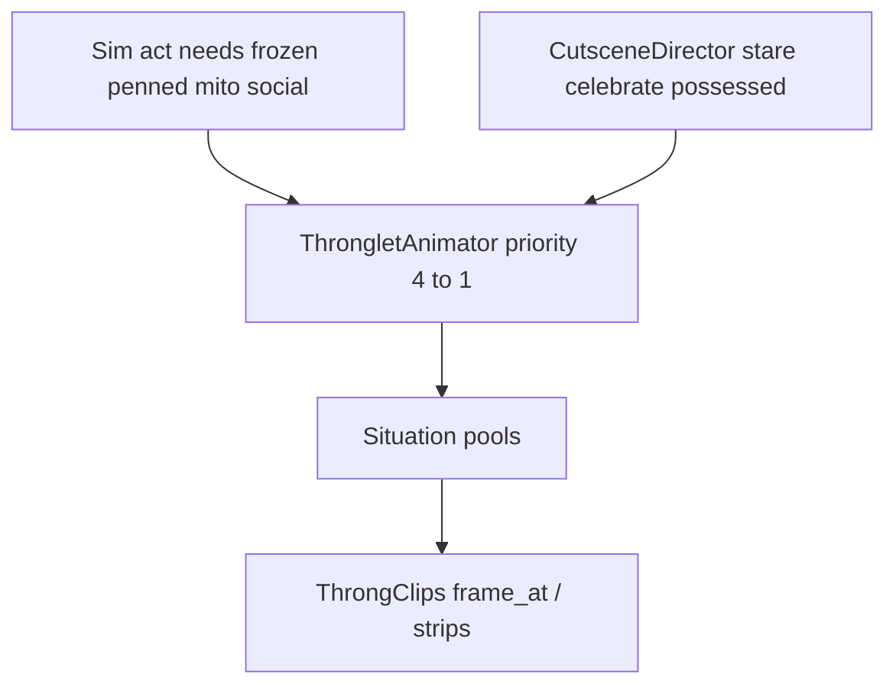

Keep sim authoritative for `act` / needs / `frozen` / penned / social; presentation only maps those flags to clips.

## Implementation backlog (issue #37) — all tasks tied

**One delivery / one PR** covering A→E below (no split PRs). Phases are only the **build order** inside that work: finish dependencies first, ship everything together, then close #37.

Each task cites **depends on**, **touches**, **situation/clips**, and **done when**.

### Already done (pre-backlog + this delivery)

| ID | What | Evidence |
| --- | --- | --- |
| D1 | R&D situation → clip map | This document |
| D2 | Per-animation strip PNGs + manifest | `resources/sprites/throng_anims/`, `tools/export_throng_anims.py` |
| D3 | `ThrongClips.frame_at` / `strip_frame` / `sprite_frames`; `make_art` packs strips into `world_iso` | `scripts/data/throng_clips.gd`, `tools/make_art.py` |
| D4 | Situation-correct base acts | `Main._frame` |
| **A1–A8** | Pools + tiered `_frame` + bored/talk/sing/penned | `throng_clips.gd`, `Main.gd`, `throng_tune.gd` |
| **B1–B5** | Extract/pack Unity sheets; panic/carry/mood walks wired | `pack_extra_throng_clips.py`, atlas cells 654+, `_walk_clip` / carry |
| **B6** | Deflesh | **N/A** — sheet packed; kill path stays Dead (no deflesh tool state) |
| **C1–C7** | Stare stagger + react, unlock celebrate, possessed, ReactToKill, mito along, sleep; post-eat → Happy (no Rotund / eat-cheer) | `frozen`/`glitch_t`/`celebrate_t`/`react_t`/`sleep_t` |
| **D1w** | Walk_Homed | `approaching_home` |
| **D2w** | Theatre masks | **N/A** — no body cosmetics layer yet |
| **D3w** | Pollution sheet | **N/A (optional)** — DirtTex shader primary |
| **E1–E2** | Docs + shot samples | This section, `video-gaps.md`, `shot_capture.gd` |
| **E3** | Close #37 | GitHub |

### Phase A–E task tables (historical)

Kept for dependency context; all IDs above are shipped or N/A with reason in the mismatch table.

| ID | Done when (summary) | Status |
| --- | --- | --- |
| A1 | Pools exist; no kitchen-sink IDLE | Done |
| A2 | Tiered `_frame` | Done |
| A3 | Bored → MOOD_BORED | Done |
| A4 | Frozen → TALK_CONSOLE only (+ react accents) | Done |
| A5 | Sing near peer | Done — real `peer_t` beat (pair + face + hold), not idle paint |
| A6 | TALK_PEER near peer | Done — same `peer_t` path; #17 bubbles still open |
| A7→B3 | Penned panic body | Done |
| A8 | Tune/shots no CALM misuse | Done |
| B1–B2 | Extract + pack | Done |
| B4 | Carry LiftProp / LiftPropWalk | Done (`carry` state) |
| B5 | Happy/Sad walk + Puppy + InAwe | Done |
| B6 | Deflesh | N/A |
| C1–C7 | Cinematics | Done |
| D1w | Walk_Homed | Done |
| D2w–D3w | Theatre / pollution sheet | N/A |
| E1–E3 | Docs + close | Done |

### Dependency graph

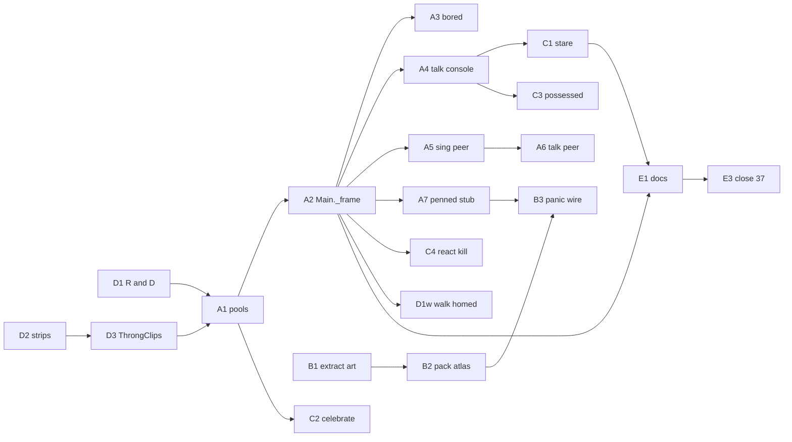

### Single-PR acceptance

**Met.** A1–A8, B1–B5, C1–C7, D1w, E1–E2 shipped; B6 / D2w / D3w documented N/A in the mismatch table. E3 closes #37.

### Out of scope for #37 (tracked elsewhere)

- Full `SEQ_1`–`SEQ_8` timeline player (names-only JSON today)
- Market / zoom / building focus issues (#36, #30, #18)
- Tutorial hand UI (video-gaps World and tools) — related care order only via C5
- Replacing MultiMesh with per-thronglet `AnimatedSprite2D` nodes (strips already feed `sprite_frames()` for non-swarm use)

## References

- Issue: https://github.com/enegalan/thronglets-infinite/issues/37
- Per-animation strips: [`../resources/sprites/throng_anims/`](../resources/sprites/throng_anims/) (runtime) / [`thronglet-anims/`](thronglet-anims/) (docs) — export [`tools/export_throng_anims.py`](../tools/export_throng_anims.py)
- Clip API: [`scripts/data/throng_clips.gd`](../scripts/data/throng_clips.gd) (`frame_at`, `strip_frame`, `sprite_frames`)
- Gaps / checklist: [`video-gaps.md`](video-gaps.md) § Thronglet animations & sprites catalog
- Runtime clips: [`scripts/data/throng_clips.gd`](../scripts/data/throng_clips.gd)
- Frame select: [`scripts/presentation/Main.gd`](../scripts/presentation/Main.gd) `_frame`
- Penned bark: [`scripts/core/ThrongletSimServer.gd`](../scripts/core/ThrongletSimServer.gd) `_is_penned` / `_thought_icon`
- Unity sprites: `references/Assets/Sprite/Throng*.json`, `Char_Throng*.json`
- Timelines (names only today): `references/Assets/ScriptableObjectGroup/ThrongletTalkTimeline.json`, `SEQ_1.json`–`SEQ_8.json`
